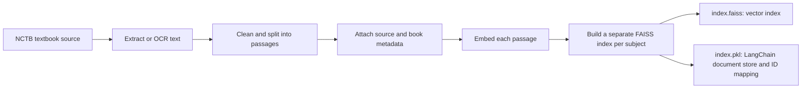
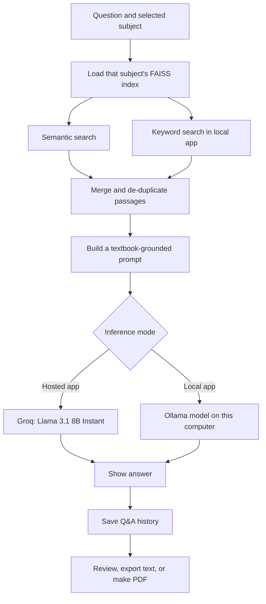

# NCTB Textbook Q&A Assistant

A retrieval-augmented generation (RAG) assistant for questions grounded in NCTB Class 11–12 English, Bangla, and ICT textbooks. It retrieves passages from the selected book before asking a language model to answer, instead of relying on the model's general knowledge alone.

The project includes a hosted/API-powered Gradio app and a separate local app that can run inference through Ollama.

## What the project does

- Search three subject-specific textbook indexes.
- Combine semantic vector search and lexical keyword matching in the local app.
- Keep answer prompts tied to the retrieved textbook excerpts and instruct the model not to guess beyond them.
- Correct likely OCR/spelling corruption in retrieved Bangla and ICT excerpts in the local app.
- Accept English and Bangla questions, including browser speech input where supported.
- Save Q&A history, restore it in the interface, and export it as text or a revision PDF.
- Offer a hosted Groq model path and an Ollama local-inference path.

## From textbook to searchable FAISS index

The chatbot uses prebuilt, subject-specific LangChain FAISS indexes. At a high level, the indexing workflow is:



The repository includes the resulting index artifacts:

| Subject | Index directory | Contents |
|---|---|---|
| English | `nctb_english_index_v2/` | `index.faiss` and `index.pkl` |
| Bangla | `nctb_bangla_index_v2/` | `index.faiss` and `index.pkl` |
| ICT | `nctb_ict_index_better/` | `index.faiss` and `index.pkl` |

Both apps load these indexes with `sentence-transformers/paraphrase-multilingual-MiniLM-L12-v2`. The embedding model used at query time must match the model used to build the stored vectors; otherwise, similarity search is incompatible.

### Indexing provenance and reproducibility

The checked-in deliverables are the prebuilt FAISS index files and the chatbot applications. The original textbook PDFs/source corpus and a script for extracting, cleaning, chunking, and building the indexes are **not included**. Consequently, the exact source editions, OCR engine/settings, chunk size/overlap, and index-build run cannot be independently reproduced from this repository alone. The flowchart documents the indexing stages, not an undocumented claim about a particular OCR or PDF-processing tool.

`index.pkl` is a serialized LangChain document store and mapping. Loading it uses LangChain's dangerous-deserialization option; only load index files from a source you trust. Respect the rights and distribution terms of the original textbook material.

## How a question is answered



The two runtimes share the same book indexes and multilingual query embedding model, but have different retrieval and inference behavior:

| Runtime | Entry point | Retrieval | Answer generation | Network requirement |
|---|---|---|---|---|
| Hosted/API-powered | `app.py` | Top 10 semantic matches from the selected FAISS index | Groq `llama-3.1-8b-instant` | Internet and `GROQ_API_KEY` |
| Local inference | `app_offline.py` | Top 3 semantic matches plus top 2 keyword matches; de-duplicates and keeps up to 4 passages | Selected Ollama model; defaults to `gemma3:4b` | Internet for first-time setup; local inference after setup |

In the local app, each selected passage is limited to 800 characters and the assembled context to 2,000 characters. For Bangla and ICT books, the selected local model is also asked to correct likely OCR spelling errors in retrieved text; if that correction fails or changes the passage length substantially, the original text is retained. The final prompt asks for a concise answer based only on the context and an explicit fallback when the excerpts do not contain the answer.

The local model menu includes `gemma3:4b`, `gemma3:1b`, `phi3.5`, and `deepseek-r1:1.5b`. The code maps the last model to `gemma3:4b` as a hardware fallback and tries `gemma3:1b` if the chosen Ollama model is unavailable.

## Components

- **UI:** Gradio.
- **Vector search:** FAISS CPU through LangChain.
- **Embeddings:** `sentence-transformers/paraphrase-multilingual-MiniLM-L12-v2`.
- **Hosted inference:** LangChain Groq integration.
- **Local inference:** Ollama.
- **Language support:** English and Bangla, with English, Bangla, and ICT textbook choices.
- **Voice input:** Browser Web Speech API; availability depends on the browser and network.
- **History and revision:** Local `chat_history.json`, text export, and FPDF-based PDF export.

## Run locally

The chatbot folder is part of the main AmplifyWebsite repository; it is not a nested Git repository. Clone the main project, then enter this directory:

```bash
git clone https://github.com/adnanmiacse-coder/AmplifyWebsite.git
cd AmplifyWebsite/book-chatbot-better
python -m venv .venv
```

Activate the environment:

```powershell
# Windows PowerShell
.\.venv\Scripts\Activate.ps1
```

```bash
# macOS or Linux
source .venv/bin/activate
```

Install the shared and local-app dependencies:

```bash
python -m pip install --upgrade pip
python -m pip install -r requirements.txt
python -m pip install langchain-huggingface fpdf ollama
```

### Hosted/API-powered app

Set a Groq API key in the environment. Keep the key private; do not commit it to Git:

```powershell
# Windows PowerShell
$env:GROQ_API_KEY = "your-groq-api-key"
python app.py
```

```bash
# macOS or Linux
export GROQ_API_KEY="your-groq-api-key"
python app.py
```

Open [http://127.0.0.1:7860](http://127.0.0.1:7860). The app sends inference requests to Groq.

### Local Ollama app

Install [Ollama](https://ollama.com/download), start its local service, and download a model before launching:

```bash
ollama pull gemma3:4b
ollama list
python app_offline.py
```

Open [http://127.0.0.1:7860](http://127.0.0.1:7860). The first run downloads the sentence-transformer embedding model; after packages, embeddings, and an Ollama model are installed, text retrieval and answer generation run locally. Browser speech recognition, externally hosted fonts, and downloading Bengali PDF fonts may still need an internet connection.

## Repository map

```text
book-chatbot-better/
├── app.py                         # Gradio + Groq app
├── app_offline.py                 # Gradio + Ollama app
├── requirements.txt               # Shared/base Python dependencies
├── nctb_english_index_v2/
│   ├── index.faiss
│   └── index.pkl
├── nctb_bangla_index_v2/
│   ├── index.faiss
│   └── index.pkl
└── nctb_ict_index_better/
    ├── index.faiss
    └── index.pkl
```

`app_offline.py` additionally needs `langchain-huggingface`, `fpdf`, and `ollama`, installed by the commands above. Conversation history is generated locally when the application runs; do not publish personal conversations or API keys.

## License and acknowledgments

The repository declares the MIT License for its software. Textbook content and any source material remain subject to their respective rights and licenses; the software license does not grant rights to redistribute the books.
